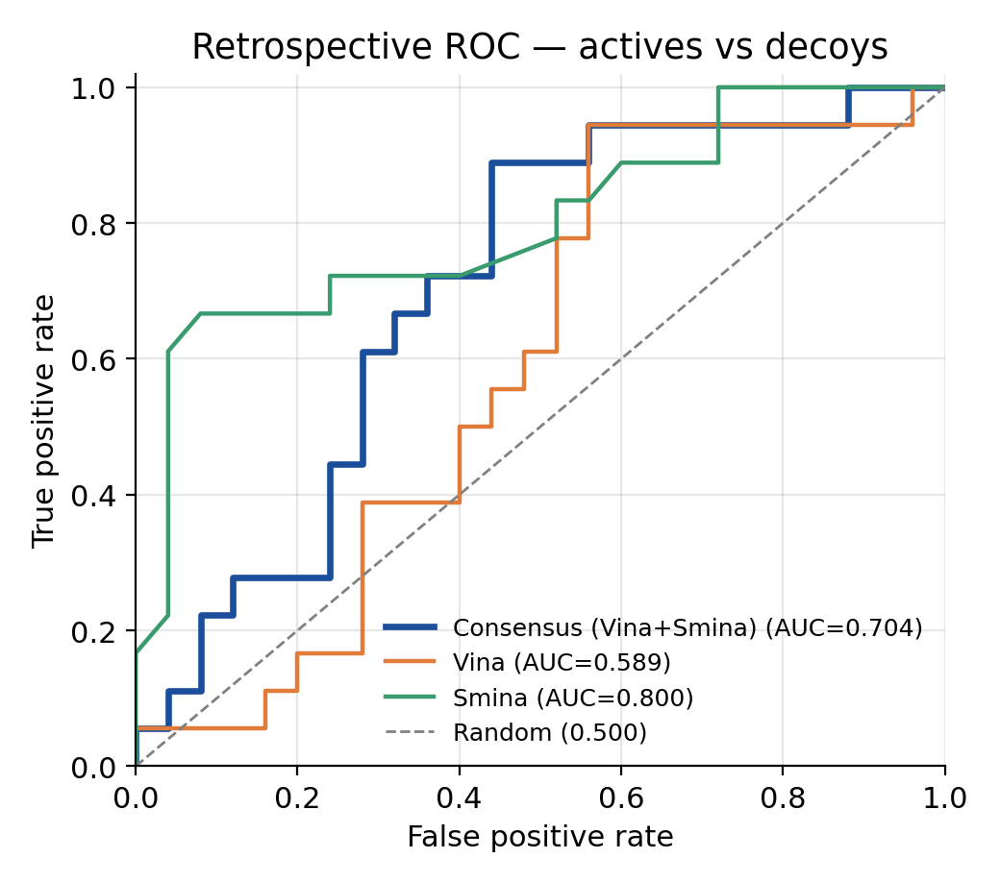
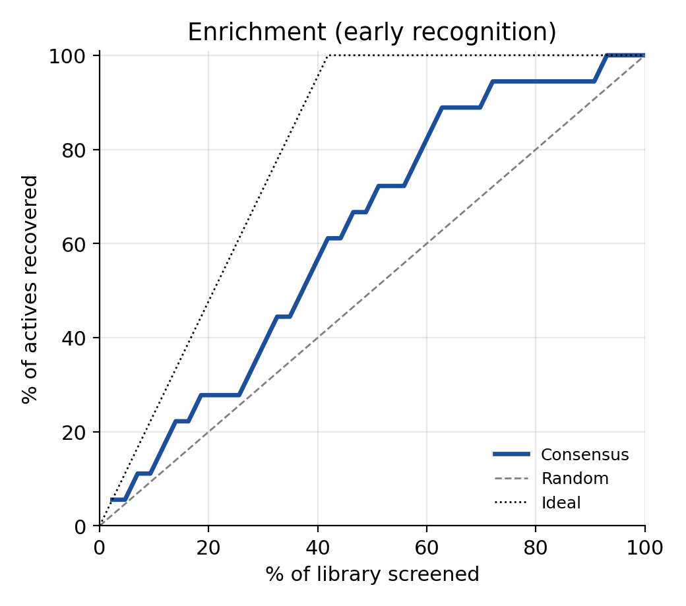
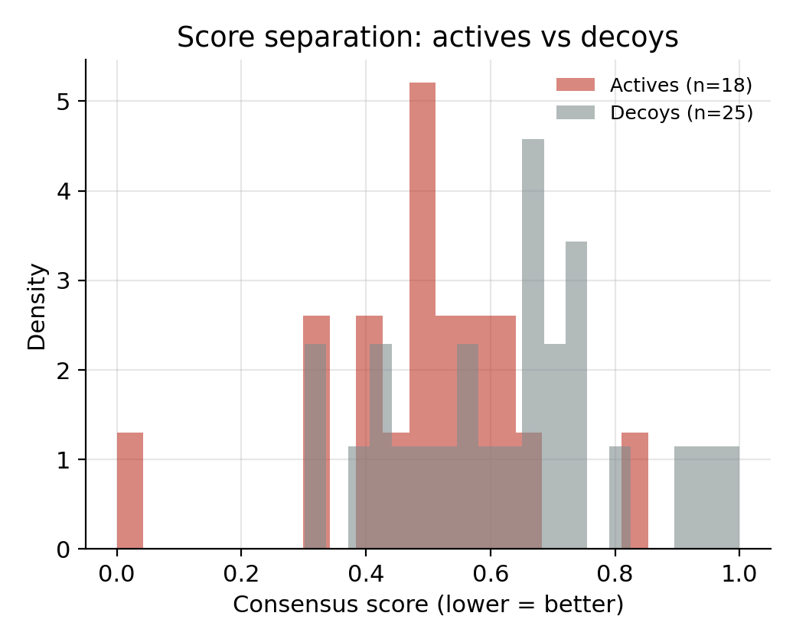
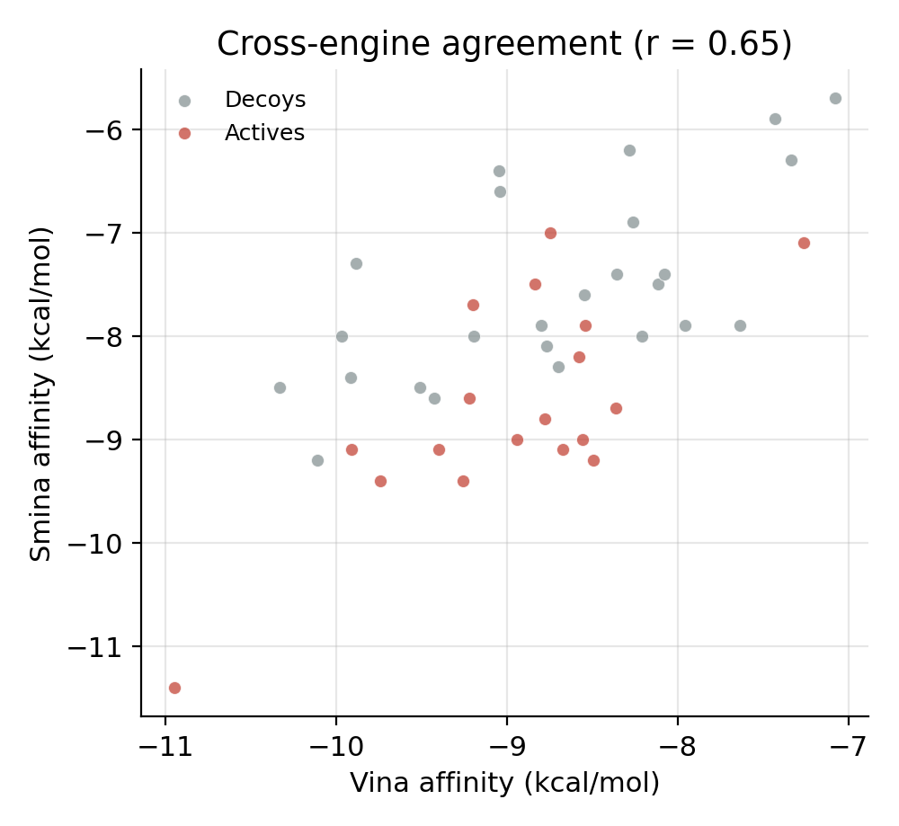

# Consensus Docking Report — CDK2 (1H00)

_100% open-source pipeline: AutoDock Vina + Smina consensus, with automatic self-validation._

## Executive summary

On **CDK2 (1H00)**, the protocol reproduces the known crystal pose (redock RMSD 1.34 Å); it separates actives from decoys with AUC-ROC 0.704 and 2.4× enrichment in the top 1%.

This pipeline's novelty is not a single new score but a **defensible workflow**: two independent open-source engines are combined into a consensus ranking, and the same run automatically checks itself two ways — by re-docking the native ligand (does it recover the real binding mode?) and by screening known actives against decoys (does the ranking actually enrich for binders?). Every number below is produced by the run itself, not entered by hand.

## How the pipeline works

1. **Prepare** the target (clean, protonate at physiological pH, assign AutoDock atom types) and each ligand (standardise, 3D embed, protonate).
2. **Locate the pocket** from the co-crystallised ligand when present, or with fpocket for an apo structure, and build the search box.
3. **Dock with two engines** — AutoDock Vina (physics-empirical score) and Smina (Vinardo score) — which use different scoring functions, so agreement between them is meaningful signal.
4. **Consensus rank** each ligand by combining its rank and its normalised score across both engines (`consensus_z`, lower = better), plus an `agreement` term that flags where the two engines concur.
5. **Self-validate** with redock RMSD and retrospective enrichment metrics (below).

## 1. Protocol validation — does the method reproduce known truth?

**Pose reproduction (native-ligand redock):** top-pose RMSD = **1.34 Å**, best-of-N = 1.30 Å → **PASS** (<2 Å).

*What this is:* we take the ligand from the crystal structure, strip it out, and dock it back blind. If the top pose lands within 2 Å (heavy-atom, symmetry-corrected RMSD) of where it really sits, the search and scoring are trustworthy for this target.

*Reading this run:* An RMSD of 1.34 Å is below the 2 Å threshold conventionally used to define a *correct* pose, so the protocol reproduces the known binding mode. This is the standard evidence that the search box, scoring function and preparation are all working for this target.

**Retrospective screening (known actives vs. decoys):**

| Metric | Value | What it measures |
|---|---|---|
| AUC-ROC (consensus) | **0.704** | overall ranking power (0.5 = random) |
| AUC-ROC (Vina only) | 0.589 | single-engine baseline |
| AUC-ROC (Smina only) | 0.800 | single-engine baseline |
| EF @ 1% | 2.39 | fold-enrichment in the top 1% |
| EF @ 5% | 1.19 | fold-enrichment in the top 5% |
| EF @ 10% | 1.19 | fold-enrichment in the top 10% |
| BEDROC (α=20) | 0.633 | early-recognition (weights top of list) |
| Actives / Decoys | 18 / 25 | benchmark composition |

*Reading this run:*

- AUC-ROC = 0.704 indicates **good** separation of known actives from decoys. AUC is the probability that a randomly chosen active is ranked above a randomly chosen decoy: 0.5 is random, 1.0 is perfect.

- EF@1% = 2.39 means the top 1% of the ranked library is enriched in true actives 2.4× over what random picking would give — this is the number that matters most in a real campaign, where you only assay the top handful of compounds.

- On this run a single engine (best single AUC 0.800) edged out the consensus (0.704). With small or noisy libraries the engines occasionally disagree in a way that hurts the average; the consensus advantage is most reliable on larger, well-powered screens. The value of consensus is robustness across targets, not a guaranteed win on every run.

- **BEDROC (α=20)** answers a different question from AUC: it weights the very top of the ranked list, matching how screening is used in practice (you only test the top few). A value near 1 means actives cluster at the top; near 0 means they are scattered.


## 2. Figures

### ROC curves


*Each curve traces true-positive vs false-positive rate as the score threshold sweeps. A curve bowing toward the top-left is better; the diagonal is random. Compare the consensus curve against the two single-engine curves to see the effect of combining them.*

### Enrichment


*Fraction of actives recovered vs. fraction of the library screened. The steeper the early rise, the more actives you catch while testing only a small slice — the practical payoff of a good ranking. The black dotted line is the theoretical ideal, grey is random.*

### Score separation


*Distribution of the consensus score for actives (red) vs decoys (grey). Good separation — actives shifted toward better (lower) scores with little overlap — is what drives the AUC and EF above.*

### Cross-engine agreement


*Vina vs Smina affinity for every compound, coloured by label. Points on a tight diagonal mean the two independent engines concur; the annotated Pearson r quantifies it. Consensus is most trustworthy where the engines agree.*


## 3. Top consensus hits

Ranked by `consensus_z` (lower = better). `agreement` near 1 means Vina and Smina independently favour the compound — the hits you can trust most. `label` (if present) marks known actives (1) vs decoys (0) from the benchmark; on a real event-day target every compound is unlabelled.

|   final_rank | id            |   label |   vina_score |   smina_score |   consensus_z |   agreement |
|-------------:|:--------------|--------:|-------------:|--------------:|--------------:|------------:|
|            1 | CHEMBL321939  |       1 |      -10.95  |         -11.4 |      0        |    1        |
|            2 | CHEMBL392371  |       0 |      -10.111 |          -9.2 |      0.301268 |    0.830607 |
|            3 | CHEMBL269882  |       1 |       -9.744 |          -9.4 |      0.331092 |    0.960429 |
|            4 | CHEMBL326320  |       0 |      -10.331 |          -8.5 |      0.334278 |    0.651011 |
|            5 | CHEMBL272165  |       1 |       -9.913 |          -9.1 |      0.335595 |    0.864173 |
|            6 | CHEMBL269883  |       1 |       -9.259 |          -9.4 |      0.393688 |    0.914377 |
|            7 | CHEMBL115284  |       0 |       -9.919 |          -8.4 |      0.396224 |    0.739817 |
|            8 | CHEMBL410072  |       1 |       -9.398 |          -9.1 |      0.402064 |    0.997111 |
|            9 | CHEMBL324257  |       0 |       -9.972 |          -8   |      0.424472 |    0.655961 |
|           10 | CHEMBL231948  |       0 |       -9.511 |          -8.5 |      0.440111 |    0.862679 |
|           11 | CHEMBL219916  |       0 |       -9.426 |          -8.6 |      0.44231  |    0.902164 |
|           12 | CHEMBL1964245 |       1 |       -9.222 |          -8.6 |      0.468639 |    0.954823 |
|           13 | CHEMBL1964246 |       1 |       -8.942 |          -9   |      0.46969  |    0.902725 |
|           14 | CHEMBL23327   |       1 |       -8.675 |          -9.1 |      0.495379 |    0.81626  |
|           15 | CHEMBL850     |       0 |       -9.885 |          -7.3 |      0.497104 |    0.555611 |

## 4. Docking box

The search space the engines explored. A `ligand-guided` box is centred on the co-crystal ligand; an `fpocket` box comes from apo cavity detection.

- method: `ligand-guided`
- center: [1.97, 27.56, 8.82]
- size (Å): [20.3, 23.9, 18.0]


## 5. Limitations & honest caveats

- Docking scores are approximate free-energy estimates, not experimental affinities — rankings are far more reliable than absolute numbers.
- Retrospective enrichment uses property-matched decoys; real prospective performance is usually lower.
- A single receptor conformation is used (no explicit protein flexibility beyond side-chain sampling in the box).
- Metrics on small libraries carry large error bars; trust them most on the full benchmark run.


## 6. Reproducibility

Every tool is open-source and every step is scripted and seeded. Versions used for this run:

```
AutoDock Vina: 1.2.7
Smina: Vina 1.1.2 (Nov 2017)
OpenBabel: 3.1.0
RDKit: 2025.03.6
ProLIF: 2.2.0
scikit-learn: 1.9.0
```
